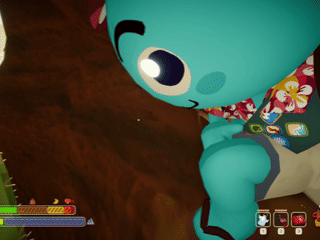

 


# Whispers of the North

**Género:** Aventura, Misterio, Exploración, Fantasía, RPG  
**Plataforma:** PC  
**Perspectiva:** 2D / 2.5D  

## Historia

En un mundo moderno un joven se muda con su familia a un pueblo misterioso de los países nórdicos donde los habitantes conviven con criaturas nunca antes vistas donde siguen reglas y tradiciones muy extrañas.

## Objetivo

Descubrir el origen de las criaturas y las tradiciones del pueblo.

## Mecánica principal

Combate por turnos, Investigación, Puzzles, Bestiario, Elementos

## ¿Qué lo hace diferente?

Mientras que muchos juegos basados en la cultura y mitología nórdica tratan de vikingos, dioses y guerras, este busca un enfoque más doméstico y de fantasía, como si fuera cuento de hadas.

---

## Estado del proyecto — 16 de noviembre de 2026

Demo en Godot 4.7.2 / GL Compatibility. Hay cinco zonas conectadas, casa con tutorial, combate contra Jarritos, inventario de exploración y presentación nórdica integrada. El contenido completo de cueva/bosque, jefe/final, consumibles en combate y guardado completo siguen pendientes. Investigación, puzzles, bestiario y elementos descritos arriba son parte de la visión, no una lista de sistemas terminados.

- [Estado por fases, validaciones y pendientes](docs/AVANCE_DEMO.md)
- [Assets, decoración e iluminación](docs/ASSETS_INTEGRACION.md)
- [Inventario y pausa](docs/MENU_PAUSA_E_INVENTARIO.md)
- [Combate](docs/SISTEMA_COMBATE.md) y [Jarrito](docs/JARRITO_COMBATE.md)
- [Cámaras](docs/SISTEMA_CAMARAS_Y_SWITCHES.md) y [controles](docs/INPUT_MAP.md)

## Ejecutar la demo

Abrir `project.godot` en Godot 4.7.2 y ejecutar F5. La escena principal es `scenes/ui/MainMenu.tscn`; Nueva partida inicia en la casa. F6 permite ejecutar un mapa o escena de prueba individual. Los controles efectivos se consultan en el Input Map y el menú Controles.

## Estructura actual

```text
scenes/world/       World_House, World, World_Town, World_Cave, World_ForestRuins
scenes/world/Entities/  Jarrito, cofres, arbustos, fuente, faroles y NordicProps
scenes/ui/          MainMenu, PauseMenu, ControlsMenu
scenes/combat/      CombatArena, battlers y escenas de prueba
scripts/core/      game_state.gd
scripts/world/     Controladores de zona, entidades, transiciones y presentación
scripts/combat/    Coordinación de encuentros, turnos, combatientes y acciones
scripts/inventory/ Inventory, InventoryItem, ItemDatabase y pools
scripts/dialogue/ Interacciones integradas con Dialogue Manager
scripts/vfx/       Efectos transitorios nórdicos
data/              Objetos, pools, diálogos, combate y buses de audio
assets/            Modelos, sprites, audio, fuentes y shaders
tests/             Suites funcionales y scripts de revisión visual
docs/              Estado, integración y guías técnicas
```

### Autoloads registrados

| Nombre | Ruta | Uso |
| --- | --- | --- |
| GameState | `scripts/core/game_state.gd` | HP, stats, inventario y progreso entre mapas; reinicio de partida. |
| CoordinadorEncuentros | `scripts/combat/coordinador_encuentros.gd` | Reserva, sesión y cierre de encuentros. |
| DialogueManager | `addons/dialogue_manager/dialogue_manager.gd` | Motor de diálogos. |

No existe un SaveSystem global integrado. La persistencia del recorrido se mantiene en memoria durante la partida.

### 🌿 Ramas de Git sugeridas por módulo

```
main           ← Código estable / integración
dev            ← Rama de integración del equipo
├── feat/combat        (Combate por turnos + Elementos)
├── feat/dialogue      (Sistema de diálogo + Bestiario)
├── feat/world         (Mapas + Exploración)
├── feat/ui            (HUD + Menús + Inventario)
└── feat/puzzles       (Puzzles + Mecánicas de investigación)
```

---

## 🎮 Controles (Input Map estándar)

Los controles se definen **solo** en Project Settings → Input Map (nunca por código).

| Acción | Teclado | Gamepad |
|---|---|---|
| `move_up/down/left/right` | WASD / Flechas | Stick izq. / D-pad |
| `interact` | Z / E / Enter / Espacio | Botón A |

Guía completa (cómo usarlas, añadir acciones y preparar el remapeo): [docs/INPUT_MAP.md](docs/INPUT_MAP.md)

---

## ⚙️ Configuración Inicial del Repositorio

### 1. Clonar el repositorio

```bash
git clone https://github.com/lugalnt/whispers-north.git
cd whispers-north
```

### 2. Instalar Git LFS

Git LFS permite versionar archivos binarios pesados (sprites, audio, modelos) sin inflar el historial de git.

#### Windows
```bash
# Opción A — Winget
winget install GitHub.GitLFS

# Opción B — Descarga directa
# https://git-lfs.com/
```

#### macOS
```bash
brew install git-lfs
```

#### Linux (Debian/Ubuntu)
```bash
sudo apt install git-lfs
```

#### Activar LFS en el repositorio (solo una vez por máquina)
```bash
git lfs install
```

### 3. Verificar que LFS está trackeando los archivos

Tras clonar, ejecuta:
```bash
git lfs ls-files
```
Deberías ver los archivos de assets listados. Si no hay ninguno todavía, es normal — LFS se activa cuando subes el primer archivo binario.

### 4. Tipos de archivo trackeados por LFS

Ya están configurados en `.gitattributes`. Los tipos incluidos son:

```bash
# Imágenes
*.png  *.jpg  *.jpeg  *.psd  *.aseprite

# Audio
*.wav  *.ogg  *.mp3

# Modelos 3D
*.blend  *.fbx  *.glb  *.gltf

# Tipografías
*.ttf  *.otf

# Video
*.mp4  *.webm
```

Para añadir nuevos tipos en el futuro:
```bash
git lfs track "*.extension"
git add .gitattributes
git commit -m "chore: track *.extension with LFS"
```

### 5. Abrir el proyecto en Godot

1. Descarga **Godot 4.x** desde [godotengine.org](https://godotengine.org/download)
2. Abre el Project Manager
3. Haz clic en **"Importar"** y selecciona `project.godot` en la carpeta del repositorio

### 6. Flujo de trabajo en equipo

```bash
# Antes de empezar a trabajar
git checkout dev
git pull origin dev
git checkout -b feat/tu-modulo


# Al terminar tu trabajo
git add .
git commit -m "feat: descripción de lo que hiciste"
git push origin feat/tu-modulo
# → Abre un Pull Request hacia 'dev'
```

---

## 🐛 Convención de commits

```
feat:     nueva funcionalidad
fix:      corrección de bug
art:      assets de arte (sprites, audio, etc.)
docs:     documentación
chore:    configuración, limpieza
refactor: refactorización sin cambiar funcionalidad
```

**Ejemplo:**
```bash
git commit -m "feat(combat): añadir sistema de turnos básico"
git commit -m "art(sprites): agregar spritesheet del jugador idle"
```

---

## 📌 Recursos útiles

- [Documentación oficial de Godot 4](https://docs.godotengine.org/en/stable/)
- [GDScript style guide](https://docs.godotengine.org/en/stable/tutorials/scripting/gdscript/gdscript_styleguide.html)
- [Git LFS Documentation](https://git-lfs.com/)
- [Godot — Best Practices](https://docs.godotengine.org/en/stable/tutorials/best_practices/index.html)
- [Godot Shaders](https://godotshaders.com)
- [Kenney (web de assest gratuitos 3d y 2d)](https://kenney.nl)